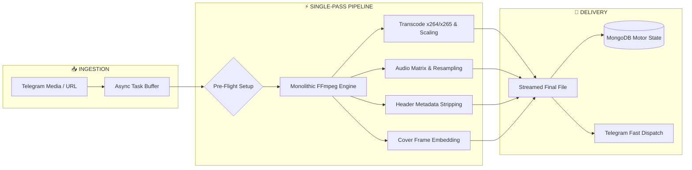

<div align="center">
 

  # ⚡ VideoEncoder Pro
  ### Next-Gen Unified Media Processing & Transcoding Engine
  <p align="center">
    <b>An enterprise-grade, asynchronous video transformation suite engineered for Telegram.</b><br>
    <i>Fuses transcode filters, dynamic track routing, metadata injection, and cover embedding into a single deterministic FFmpeg pass.</i>
  </p>

  <p align="center">
    <a href="https://www.python.org/"></a>
    <a href="https://ffmpeg.org/"></a>
    <a href="https://www.mongodb.com/"></a>
    <a href="https://www.docker.com/"></a>
  </p>

  <p align="center">
    <a href="https://t.me/Unrated_Coder"></a>
    <a href="https://t.me/Og_Luffytaro"></a>
    <a href="https://github.com/Unrated-Coder/Encoding-Bot"></a>
  </p>

</div>

---

## 📊 Pipeline Architecture

All multi-stage encoding tasks are merged into a synchronized, non-blocking single execution pass:



---

## ⚡ Performance Paradigm

| Operational Parameter | Standard Transcode Bots | ⚡ VideoEncoder Pro |
| :--- | :--- | :--- |
| **FFmpeg Passes** | 3 to 4 sequential passes | **Single Deterministic Pass** |
| **Disk I/O Overhead** | High (Writes redundant temp files) | **Near Zero (Direct pipe streaming)** |
| **CPU Frame Re-indexing** | Redundant muxing stages | **Strictly Optimized execution** |
| **Stream Management** | Hardcoded static selectors | **Dynamic Audio & Subtitle Track Router** |
| **Processing Speed** | Standard baseline | **Up to 60% Faster Delivery** |

---

## 🌟 Core Feature Matrix

### 🎛️ Interactive Pipeline Terminal
* **Pre-Flight Configuration:** Adjust CRF, target resolutions, audio codecs, and stream mappings before starting execution.
* **Stream Matrix Control:** Strip unwanted tracks or re-order preferred audio/subtitle streams via inline buttons.
* **Real-time Concurrency:** Fully asynchronous state dispatch powered by Pyrofork and Asyncio.

### 🎞️ Precision Transcoding
* **Modern Codecs:** Full support for industry-standard **H.264 (AVC)** and bandwidth-efficient **H.265 (HEVC)**.
* **Granular Quality Dial:** Comprehensive CRF control (`14` – `32`) coupled with tuning presets (`ultrafast` to `slow`).
* **Adaptive Scaling Profiles:** Scale down smoothly to `1080p`, `720p`, `576p`, `480p`, or retain original source scale.

### ✏️ Dynamic Tokenized Renamer
* **Tag Interpolation Engine:** Format automated output naming schemes via flexible placeholders:
  ```text
  {filename} · {resolution} · {codec} · {quality} · {ext}
  ```
* **Filesystem Normalization:** Built-in sanitization blocks illegal characters across POSIX, NTFS, and APFS filesystems.

### 🎨 Metadata & Artwork Engine
* **Source Sanitization:** Strip original telemetry and unwanted metadata tags using `-map_metadata -1`.
* **Container Tag Stamping:** Inject custom Title, Author, Year, and Copyright tags directly into stream headers.
* **Visual Attachment Modes:** Switch between persistent MongoDB-stored covers, extracted source frames, or zero artwork.

---

## 🕹️ Command Reference

| Command | Arguments | Operational Scope |
| :--- | :--- | :--- |
| `/start` | — | Check bot online heartbeat |
| `/help` | — | Open interactive user manual |
| `/dl` | *(Reply / File)* | Queue Telegram media into pipeline |
| `/ddl` | `[Direct URL]` | Ingest remote HTTP(S) video stream |
| `/settings` | — | Configure persistent user preferences |
| `/status` | — | Inspect host metrics, RAM load & queue state |
| `/setthumb` | *(Reply / Photo)* | Save persistent custom thumbnail |
| `/viewthumb` | — | View active thumbnail profile (`/thumb`) |
| `/delthumb` | — | Delete thumbnail record from database |

---

## ⚙️ Environment Variables

Set these in your host environment or define them inside `.env`:

```env
# ── Core Telegram Settings ──────────────────────────────────
API_ID=12345678                          # Obtained via my.telegram.org
API_HASH=your_api_hash_here              # Obtained via my.telegram.org
BOT_TOKEN=123456789:ABCdefGHIjklMNOpqr   # Obtained via @BotFather

# ── Permissions & Logging ───────────────────────────────────
OWNER_ID=123456789                       # Master Administrator ID
SUDO_USERS=987654321 1122334455          # Space-separated Administrator IDs
LOG_CHANNEL=-1001234567890               # Audit logging channel ID

# ── Storage & Directories ───────────────────────────────────
MONGO_URI=mongodb://localhost:27017/VideoEncoder
DOWNLOAD_DIR=downloads
ENCODE_DIR=encode
```

---

## 🐳 Docker Deployment *(Recommended)*

Production-ready orchestration for 24/7 uptime:

```bash
# 1. Clone repository
git clone https://github.com/Unrated-Coder/Encoding-Bot.git
cd Encoding-Bot

# 2. Configure environment
cp .env.example .env
nano .env

# 3. Spin up daemonized services
docker compose up -d --build

# 4. Stream real-time logs
docker compose logs -f bot
```

---

## 💻 Bare-Metal Setup

Ensure **Python 3.10+** and a recent release of **FFmpeg** are installed on your host system.

```bash
# Package execution
python3 -m VideoEncoder

# Direct script entry point
python3 main.py
```

---

<div align="center">

  <sub>Crafted with engineering discipline by <a href="https://t.me/Og_Luffytaro">Luffytaro</a> · Channel: <a href="https://t.me/Unrated_Coder">Unrated Coder</a></sub>

</div>

<br>

<!-- Architectural Lineage Footnote (Discreetly at the very bottom) -->
<details>
  <summary><small><b>Footnote: Origin & Architectural Lineage</b></small></summary>
  <br>
  <blockquote>
    <p>
      <small>
        <b>Engineering Notice:</b> During the earliest design phases of this project, overcoming high-throughput asynchronous process I/O bottlenecks was a significant hurdle for our team. To bootstrap our development, we initially relied on structural inspiration from <a href="https://github.com/abhinai2244/Encoding-Bot.git">abhinai2244's base repository</a>.<br><br>
      </small>
    </p>
  </blockquote>
</details>
